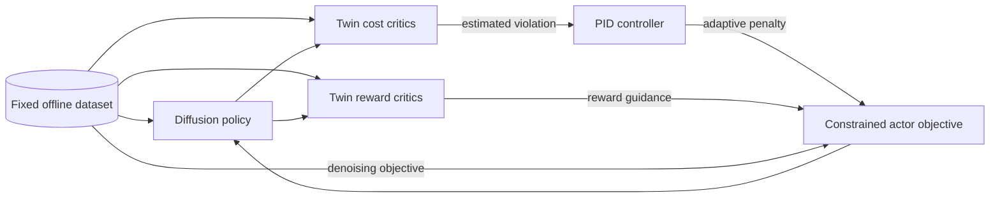
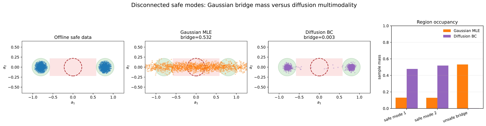
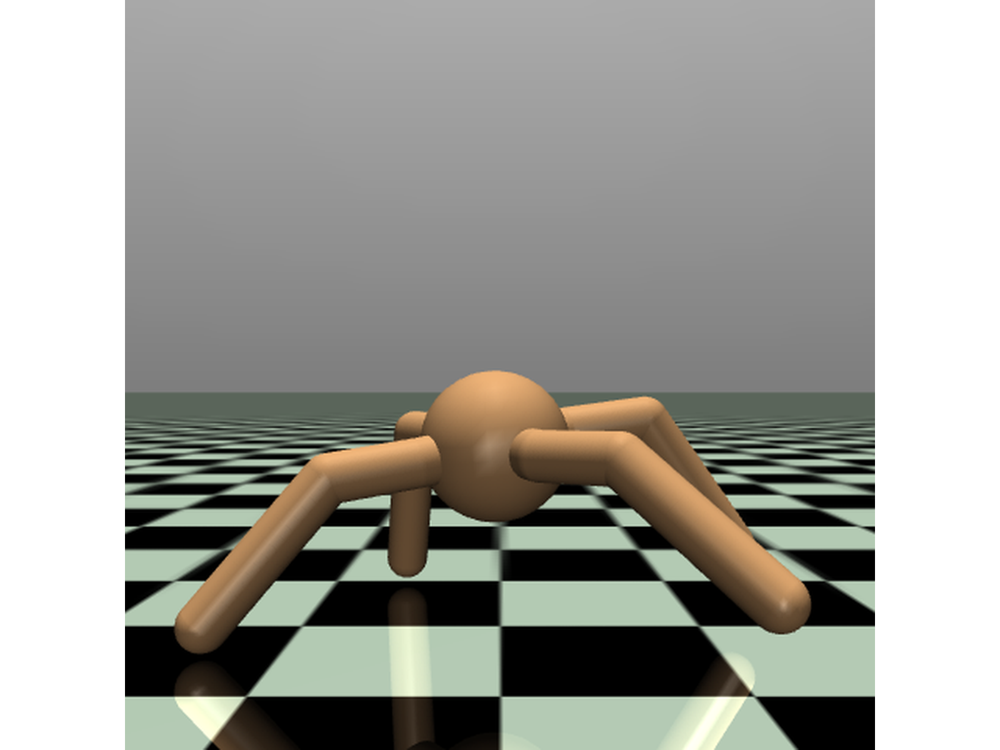
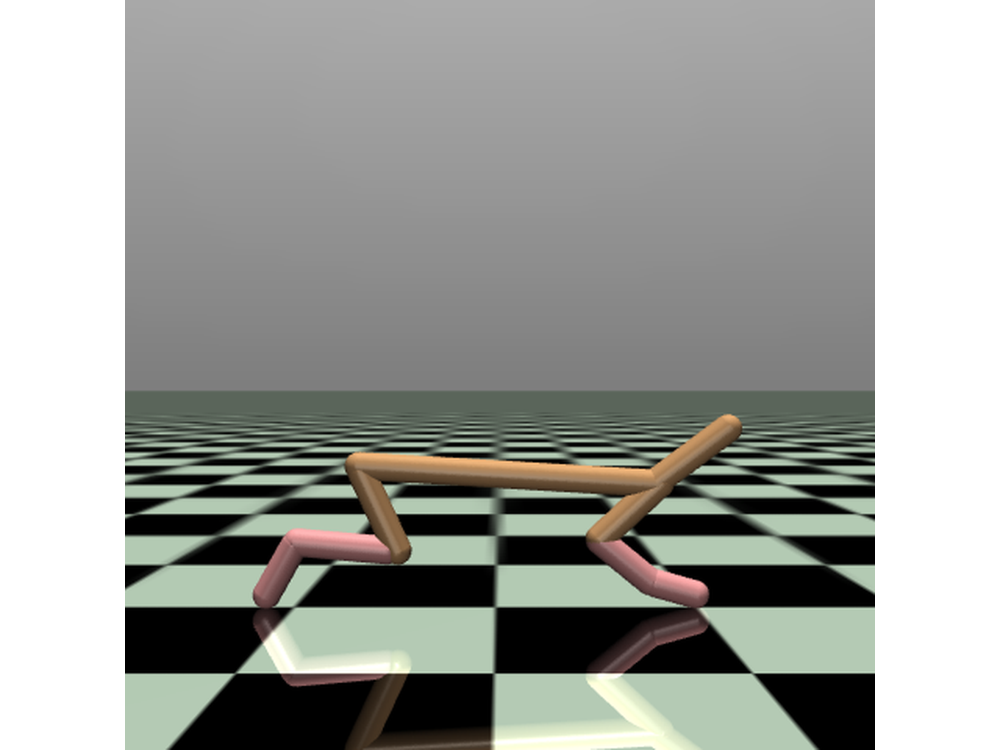
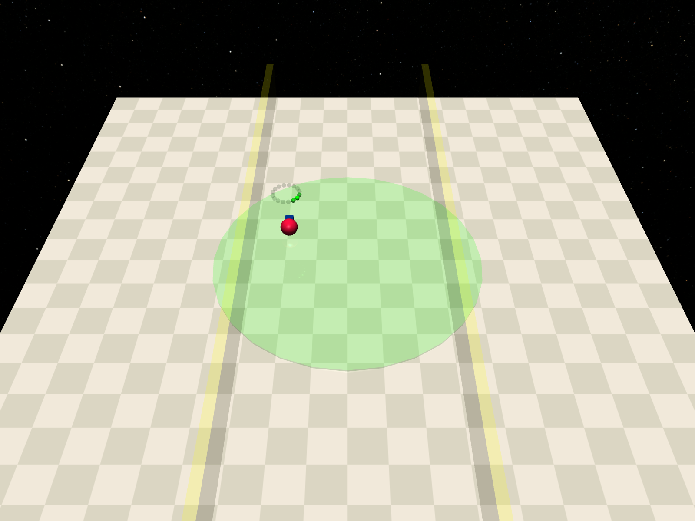
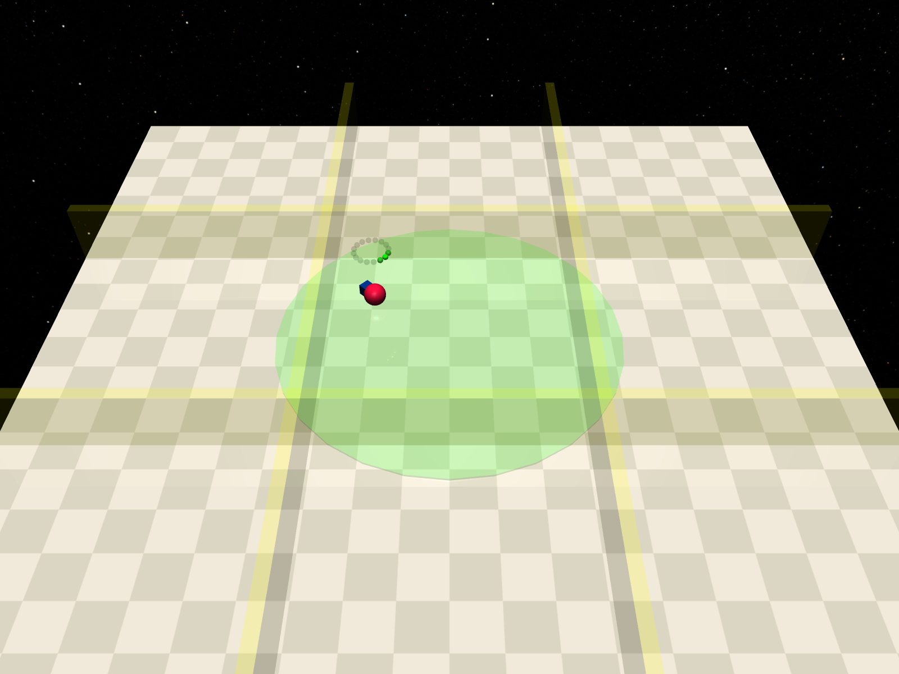

<div align="center">

# PID-DiffRL

### Safe Offline Reinforcement Learning as Noisy Delayed Feedback Control

[](https://www.python.org/)
[](https://pytorch.org/)
[](https://github.com/liuzuxin/DSRL)
[](#overview)

**PID-DiffRL** combines a diffusion policy, twin reward and cost critics, and a
PID-controlled Lagrangian multiplier for safe offline reinforcement learning.
It is designed for settings in which safety feedback is estimated from a fixed
dataset and may therefore be noisy, biased, or delayed.

[Overview](#overview) · [Installation](#installation) · [Quick start](#quick-start) · [Experiments](#experiments) · [Reproducibility](#reproducibility)

</div>

---

## Overview

Safe offline reinforcement learning seeks a high-reward policy that satisfies a
cost constraint without collecting new training data. PID-DiffRL interprets the
learned cost critic as a feedback sensor and the Lagrange multiplier as the
control signal. A proportional-integral-derivative controller adapts the safety
penalty from the estimated constraint violation.

The implementation provides:

- a diffusion actor for multimodal action distributions;
- twin reward critics and twin cost critics;
- PID adaptation with configurable proportional, integral, and derivative gains;
- an optional delayed-feedback ablation;
- offline or online checkpoint-selection protocols;
- Gaussian-policy and diffusion behavior-cloning baselines; and
- a two-dimensional safe-bridge experiment for disconnected safe action modes.



## Method intuition

When safe actions occupy disconnected regions, a unimodal Gaussian policy can
place probability mass in the unsafe space between them. A diffusion policy can
represent both modes without being forced to average through the unsafe bridge.

<p align="center">
  
</p>

## Environments

PID-DiffRL supports eleven tasks from the
[DSRL benchmark](https://github.com/liuzuxin/DSRL).

| Benchmark suite | Environments | Cost limit |
| --- | --- | ---: |
| Safety-Gymnasium | `OfflinePointCircle1Gymnasium-v0`, `OfflinePointCircle2Gymnasium-v0` | 20 |
| Safety-Gymnasium | `OfflineAntVelocityGymnasium-v1`, `OfflineHalfCheetahVelocityGymnasium-v1`, `OfflineSwimmerVelocityGymnasium-v1` , OfflineHopperVelocityGynasium | 20 |
| Bullet-Safety-Gym | `OfflineAntRun-v0`, `OfflineBallRun-v0`, `OfflineCarCircle-v0`, `OfflineDroneRun-v0`, `OfflineBallCircle-v0` | 10 |

<table>
  <tr>
    <td align="center" width="50%">
      <br>
      <b>AntVelocity</b>
    </td>
    <td align="center" width="50%">
      <br>
      <b>HalfCheetahVelocity</b>
    </td>
  </tr>
  <tr>
    <td align="center" width="50%">
      <br>
      <b>PointCircle1</b>
    </td>
    <td align="center" width="50%">
      <br>
      <b>PointCircle2</b>
    </td>
  </tr>
</table>

## Installation

The reference environment uses Python 3.9, PyTorch 1.10.1, MuJoCo 2.2,
DSRL, Safety-Gymnasium, and Bullet-Safety-Gym.

```bash
conda create -n pid-diffrl python=3.9 -y
conda activate pid-diffrl
pip install -r requirements.txt
```

The pinned PyTorch package targets CUDA 11.1. If that build is incompatible
with the local driver, install the appropriate PyTorch build first and then
install the remaining dependencies. A CUDA-capable GPU is recommended for full
benchmark runs.

## Quick start

Train PID-DiffRL on a DSRL task:

```bash
python main.py \
  --env_name OfflineHalfCheetahVelocityGymnasium-v1 \
  --algo ql \
  --ms offline \
  --exp halfcheetah_pid \
  --seed 0 \
  --device 0
```

The dataset is loaded through `env.get_dataset()`. Training updates use only
this fixed dataset; environment rollouts are used by the evaluation routine.

By default, run artifacts are stored under `results/`:

```text
results/
└── <environment>|<experiment>|<algorithm>|T-<steps>|ms-<selection>|.../
    ├── eval.npy
    ├── progress.csv
    ├── variant.json
    └── best_score_<selection>.txt
```

`progress.csv` records optimization losses, predicted cost, PID error, PID
multiplier, and evaluation metrics. `variant.json` captures the complete run
configuration.

## Experiments

### Multiple seeds

```bash
for seed in 0 1 2 3 4; do
  python main.py \
    --env_name OfflinePointCircle1Gymnasium-v0 \
    --algo ql \
    --ms offline \
    --exp pointcircle1_pid \
    --seed "$seed" \
    --device 0
done
```

### Gaussian-policy ablation

```bash
python main.py \
  --env_name OfflineSwimmerVelocityGymnasium-v1 \
  --algo gaussian-ql \
  --ms offline \
  --exp gaussian_ablation \
  --seed 0 \
  --device 0
```

### Delayed-feedback ablation

```bash
python main.py \
  --env_name OfflineBallRun-v0 \
  --algo ql \
  --pid_delay_steps 5 \
  --exp delay_5 \
  --seed 0 \
  --device 0
```

### Safe-bridge toy experiment

Run a lightweight smoke test:

```bash
python run_toy_safe_bridge.py --quick
```

Run the full experiment:

```bash
python run_toy_safe_bridge.py \
  --device cuda:0 \
  --seed 2026 \
  --output_dir toy_imgs/safe_bridge
```

The full run exports PNG/PDF visualizations together with JSON and CSV
region-occupancy metrics.


## Reproducibility

The default benchmark configuration uses:

- 1,000 epochs with 1,000 gradient updates per epoch;
- batch size 256;
- PID gains $K_P=0.01$, $K_I=0.001$, and $K_D=0.005$ for the listed tasks;
- five diffusion denoising steps; and
- seeds applied to NumPy and PyTorch.

For a fully offline selection protocol, keep `--ms offline`. Evaluation still
interacts with the environment to report reward and cost, so those metrics must
not be used for offline model selection. Full benchmark runs are compute
intensive; `run_toy_safe_bridge.py --quick` is intended only as a smoke test.

## Repository structure

```text
PID-DiffRL-GitHub/
├── agents/
│   ├── diffusion.py        # diffusion process and sampling utilities
│   ├── model.py            # policy and critic networks
│   ├── ql_diffusion.py     # PID-DiffRL implementation
│   ├── ql_gaussian.py      # Gaussian-policy ablation
│   └── bc_diffusion.py     # diffusion behavior-cloning baseline
├── figures/                # project visualizations used in this README
├── utils/                  # data sampling, logging, and shared utilities
├── main.py                 # DSRL benchmark entry point
├── run_toy_safe_bridge.py  # disconnected-safe-modes experiment
└── requirements.txt        # reference dependencies
```

## Acknowledgements

This codebase builds on
[Diffusion-QL](https://github.com/Zhendong-Wang/Diffusion-Policies-for-Offline-RL)
and uses [DSRL](https://github.com/liuzuxin/DSRL),
[Safety-Gymnasium](https://github.com/PKU-Alignment/safety-gymnasium), and
[Bullet-Safety-Gym](https://github.com/SvenGronauer/Bullet-Safety-Gym).
